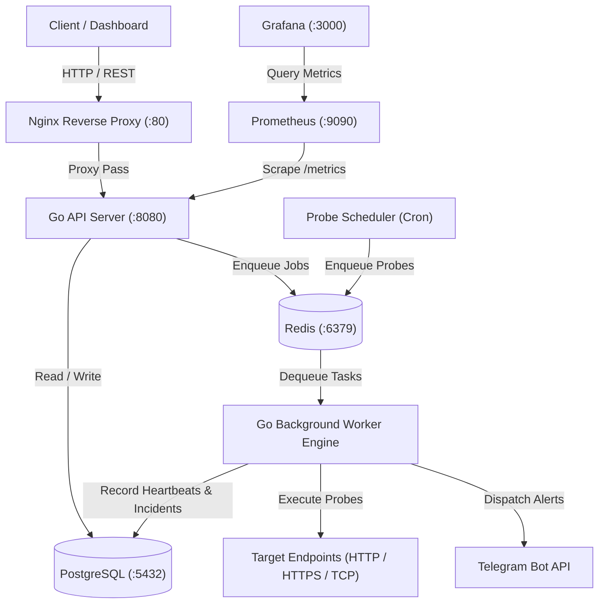

# Go Uptime Monitor & Alerting Platform

A distributed, production-ready website and service uptime monitoring platform built in Go. It features multi-protocol health probing (HTTP, HTTPS, TCP), SSL/TLS certificate tracking, automated incident lifecycle management, Telegram alert notifications with cooldown debouncing, and full observability powered by Prometheus and Grafana.

---

## Table of Contents

- [Overview](#overview)
- [Key Features](#key-features)
- [Architecture](#architecture)
- [Tech Stack](#tech-stack)
- [Prerequisites](#prerequisites)
- [Quick Start with Docker Compose](#quick-start-with-docker-compose)
- [Local Development Setup](#local-development-setup)
- [Configuration Reference](#configuration-reference)
- [API Reference](#api-reference)
- [Observability and Monitoring](#observability-and-monitoring)
- [Testing](#testing)
- [Project Structure](#project-structure)
- [License](#license)

---

## Overview

Go Uptime Monitor provides reliability engineering teams and developers with real-time visibility into the availability, performance, and SSL certificate expiration status of their web services and infrastructure endpoints. 

The system separates request handling from asynchronous background workloads:
- **API Service**: Handles user authentication, monitor management, and historical data retrieval via a RESTful interface.
- **Worker Engine**: Executes probe schedules, measures response latencies, evaluates failure thresholds, manages incident states, and dispatches alerts via Redis-backed queue workers.

---

## Key Features

- **Multi-Protocol Health Checks**: Probes HTTP, HTTPS, and raw TCP endpoints with configurable intervals, timeouts, and expected HTTP status codes.
- **SSL Certificate Expiry Tracking**: Automatically inspects SSL/TLS certificates during HTTPS probes, calculates remaining validity days, and identifies upcoming expiration risks.
- **Detailed Latency Breakdown**: Captures DNS lookup, TLS handshake duration, Time To First Byte (TTFB), and overall round-trip time.
- **Automated Incident Lifecycle**: Detects outages based on customizable consecutive failure thresholds, automatically opens incidents, records downtime, and closes them upon recovery.
- **Telegram Alerting with Debouncing**: Dispatches downtime and recovery notifications to designated Telegram channels, utilizing Redis-backed rate limiting/cooldown to prevent alert fatigue.
- **Distributed Job Processing**: Built on `hibiken/asynq` and Redis to support horizontal scalability with prioritized task queues (`probes` and `alerts`).
- **End-to-End Observability**: Exposes detailed Prometheus metrics (`/metrics`) and includes ready-to-use Grafana dashboards.
- **JWT Authentication & Security**: Secures API endpoints using JSON Web Tokens (access and refresh token pairs) and bcrypt password hashing.

---

## Architecture



---

## Tech Stack

- **Language**: Go 1.23+
- **HTTP Web Framework**: Gin (`github.com/gin-gonic/gin`)
- **Database & ORM**: PostgreSQL 16 with GORM (`gorm.io/gorm`)
- **Queue & Caching**: Redis 7 with Asynq (`github.com/hibiken/asynq`) and go-redis (`github.com/redis/go-redis/v9`)
- **Metrics & Logging**: Prometheus Go Client (`github.com/prometheus/client_golang`), Uber Zap (`go.uber.org/zap`), Lumberjack log rotation
- **Security**: Golang JWT (`github.com/golang-jwt/jwt/v5`), `golang.org/x/crypto/bcrypt`
- **Infrastructure**: Docker & Docker Compose, Nginx, Prometheus, Grafana

---

## Prerequisites

Before running the project, ensure you have the following installed on your machine:

- **Docker** (v24.0+) and **Docker Compose** (v2.20+)
- **Go** (v1.23+), if running outside containers
- **Git**

---

## Quick Start with Docker Compose

The fastest way to deploy the entire stack (API, Worker, PostgreSQL, Redis, Nginx, Prometheus, and Grafana) is via Docker Compose:

### 1. Clone the repository

```bash
git clone https://github.com/muzaim/go-grafana.git
cd go-grafana
```

### 2. Configure environment variables

Copy the example configuration file:

```bash
cp .env.example .env
```

Adjust variables in `.env` as needed (e.g., set `TELEGRAM_BOT_TOKEN` and `TELEGRAM_DEFAULT_CHAT_ID` if you want Telegram notifications).

### 3. Launch the stack

```bash
docker compose up -d --build
```

### 4. Verify deployment

Check service status:

```bash
docker compose ps
```

Verify that the API server is healthy:

```bash
curl http://localhost:8080/healthz
```

Expected response:
```json
{
  "database": "healthy",
  "status": "ok",
  "time": "2026-11-09T11:00:00Z"
}
```

### Service Endpoints

| Service | Host Port | Internal Port | Description |
| :--- | :--- | :--- | :--- |
| **Nginx Reverse Proxy** | `80` | `80` | Public gateway routing to the API |
| **API Server** | `8080` | `8080` | REST API service & `/metrics` endpoint |
| **PostgreSQL** | `5432` | `5432` | Primary relational database |
| **Redis** | `6379` | `6379` | Task queue and alert cooldown store |
| **Prometheus** | `9090` | `9090` | Time-series metrics collection |
| **Grafana** | `3000` | `3000` | Visualization dashboard (`admin` / `admin`) |

---

## Local Development Setup

To develop and test components locally without Dockerizing Go services:

### 1. Start support services (PostgreSQL & Redis)

You can launch only the storage layer with Docker:

```bash
docker compose up -d postgres redis
```

### 2. Prepare environment file

Ensure `.env` matches your local service ports:

```bash
cp .env.example .env
```

### 3. Run the API Server

Database migrations run automatically on startup:

```bash
go run cmd/api/main.go
```

The API will start listening on `http://localhost:8080`.

### 4. Run the Worker Engine

In a separate terminal:

```bash
go run cmd/worker/main.go
```

The worker connects to Redis and begins listening on `probes` and `alerts` task queues.

---

## Configuration Reference

All application parameters can be defined in `.env` or through environment variables:

| Variable | Default Value | Description |
| :--- | :--- | :--- |
| `APP_NAME` | `go-uptime-monitor` | Application name used in logs and metrics |
| `APP_PORT` | `8080` | Port for the HTTP API server |
| `APP_MODE` | `debug` | Gin runtime mode (`debug` or `release`) |
| `DATABASE_HOST` | `localhost` | PostgreSQL host |
| `DATABASE_PORT` | `5432` | PostgreSQL port |
| `DATABASE_USER` | `postgres` | PostgreSQL username |
| `DATABASE_PASSWORD` | `postgres` | PostgreSQL password |
| `DATABASE_NAME` | `uptime_monitor` | Database name |
| `DATABASE_SSLMODE` | `disable` | PostgreSQL SSL mode (`disable`, `require`, etc.) |
| `REDIS_HOST` | `localhost` | Redis host |
| `REDIS_PORT` | `6379` | Redis port |
| `REDIS_PASSWORD` | *(empty)* | Redis authentication password |
| `REDIS_DB` | `0` | Redis database index |
| `JWT_SECRET` | *(required)* | Secret signing key for JWT tokens |
| `JWT_ACCESS_TOKEN_EXPIRY_MIN` | `15` | Access token lifespan in minutes |
| `JWT_REFRESH_TOKEN_EXPIRY_DAY`| `7` | Refresh token lifespan in days |
| `TELEGRAM_BOT_TOKEN` | *(optional)* | Telegram Bot API token from `@BotFather` |
| `TELEGRAM_DEFAULT_CHAT_ID` | *(optional)* | Default Telegram chat ID for incident alerts |
| `WORKER_CONCURRENCY` | `10` | Maximum concurrent probe workers |
| `LOG_LEVEL` | `debug` | Log severity level (`debug`, `info`, `warn`, `error`) |
| `LOG_FILENAME` | `logs/app.log` | Destination path for application logs |

---

## API Reference

All protected endpoints require an `Authorization` header with a Bearer token:
```
Authorization: Bearer <your_access_token>
```

### Authentication Endpoints

#### Register a new user
- **POST** `/api/v1/auth/register`
- **Body**:
  ```json
  {
    "name": "Admin User",
    "email": "admin@example.com",
    "password": "SecurePassword123"
  }
  ```

#### Login
- **POST** `/api/v1/auth/login`
- **Body**:
  ```json
  {
    "email": "admin@example.com",
    "password": "SecurePassword123"
  }
  ```
- **Response**: Returns `access_token`, `refresh_token`, and user profile data.

#### Refresh Access Token
- **POST** `/api/v1/auth/refresh`
- **Body**:
  ```json
  {
    "refresh_token": "<refresh_token>"
  }
  ```

#### Current User Profile
- **GET** `/api/v1/auth/me` *(Protected)*

---

### Monitor Endpoints *(Protected)*

#### Create Monitor
- **POST** `/api/v1/monitors`
- **Body**:
  ```json
  {
    "name": "Production API Gateway",
    "url": "https://api.example.com/health",
    "type": "http",
    "interval_sec": 60,
    "timeout_sec": 10,
    "expected_status": 200,
    "failure_threshold": 3
  }
  ```

#### List Monitors
- **GET** `/api/v1/monitors?page=1&limit=20`

#### Get Monitor by ID
- **GET** `/api/v1/monitors/:id`

#### Update Monitor
- **PUT** `/api/v1/monitors/:id`

#### Toggle Monitor Active State
- **PATCH** `/api/v1/monitors/:id/toggle`

#### Delete Monitor
- **DELETE** `/api/v1/monitors/:id`

---

### Heartbeats and Statistics *(Protected)*

#### Get Monitor Heartbeat History
- **GET** `/api/v1/monitors/:id/heartbeats?limit=50`
- Returns recent probe results containing status, latency breakdown, HTTP status code, and SSL expiry details.

#### Get Monitor Aggregated Stats
- **GET** `/api/v1/monitors/:id/stats?duration=24h`
- Returns uptime percentage, average latency, total checks, and active incident summary.

---

### System & Telemetry Endpoints

- **GET** `/healthz` - Health probe returning service and database connectivity status.
- **GET** `/metrics` - Prometheus metrics scraper endpoint.

---

## Observability and Monitoring

### Prometheus Integration
The API server exposes standard Go runtime metrics along with custom application metrics at `/metrics`:
- `uptime_monitor_http_requests_total`: Total count of incoming API requests categorized by method, path, and status code.
- `uptime_monitor_http_request_duration_seconds`: API request latency distributions.
- `uptime_monitor_probes_total`: Number of probe executions partitioned by status (`up`, `down`) and monitor.
- `uptime_monitor_probe_duration_seconds`: Latency distributions across probe executions.
- `uptime_monitor_active_monitors`: Current count of active configured monitors.
- `uptime_monitor_incidents_total`: Total detected outage incidents.

### Grafana Dashboard
A pre-provisioned dashboard is included in [`deploy/grafana/dashboards/uptime-monitor-dashboard.json`](file:///Users/syafrisurya/project/belajar/go-up-monitoring/deploy/grafana/dashboards/uptime-monitor-dashboard.json).
When accessing Grafana at `http://localhost:3000`:
1. Log in with `admin` / `admin`.
2. The Prometheus datasource is automatically configured.
3. Open the **Uptime Monitor Dashboard** to view live uptime percentages, probe latencies, response codes, and active alerts.

---

## Testing

The project includes unit and integration tests across configuration, modules, and utilities.

### Run All Unit Tests
```bash
go test -v -race ./...
```

### Run Tests with Coverage Report
```bash
go test -coverprofile=coverage.out ./...
go tool cover -func=coverage.out
```

---

## Project Structure

```
├── cmd/
│   ├── api/                  # Main entry point for the REST API service
│   └── worker/               # Main entry point for Asynq probe worker engine
├── deploy/
│   ├── docker/               # Dockerfiles for API and Worker
│   ├── grafana/              # Grafana datasources and dashboard configurations
│   ├── nginx/                # Reverse proxy configuration
│   └── prometheus/           # Prometheus scraping configuration
├── internal/
│   ├── config/               # Viper-based configuration loader and validations
│   ├── database/             # PostgreSQL database connection and pool lifecycle
│   ├── middleware/           # JWT authentication and logging middleware
│   ├── modules/
│   │   ├── auth/             # User registration, login, and token handling
│   │   ├── heartbeat/        # Probers, latency recorder, and probe execution
│   │   ├── incident/         # Outage detector, threshold evaluation, and alerts
│   │   ├── monitor/          # Monitor CRUD operations and validations
│   │   └── notification/     # Telegram client and Redis cooldown debouncer
│   ├── queue/                # Asynq client wrapper and queue management
│   └── worker/               # Asynq task definitions, handlers, and scheduler
├── pkg/
│   ├── auth/                 # JWT token generation and bcrypt helpers
│   ├── httpclient/           # Custom HTTP client with SSL inspection
│   ├── logger/               # Uber Zap structured logger with rotation
│   ├── metrics/              # Prometheus metrics collectors and Gin handler
│   └── response/             # Standardized REST JSON response envelope
├── docker-compose.yml        # Full-stack container orchestration
├── go.mod                    # Go module dependencies
└── .env.example              # Environment variable template
```

---

## License

This project is open-source software licensed under the [MIT License](LICENSE).
